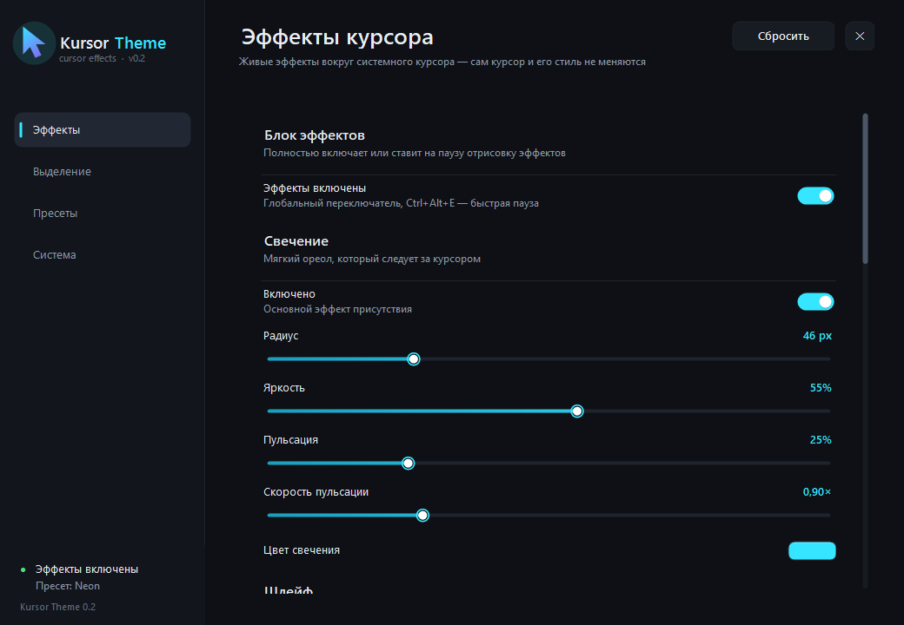
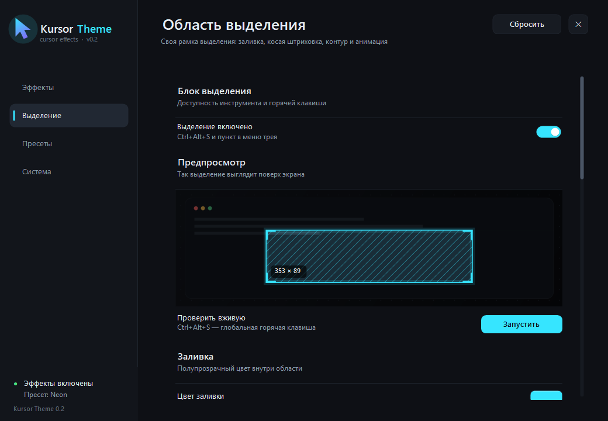
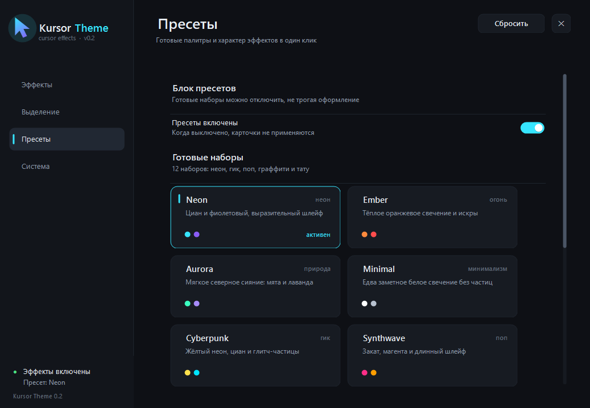
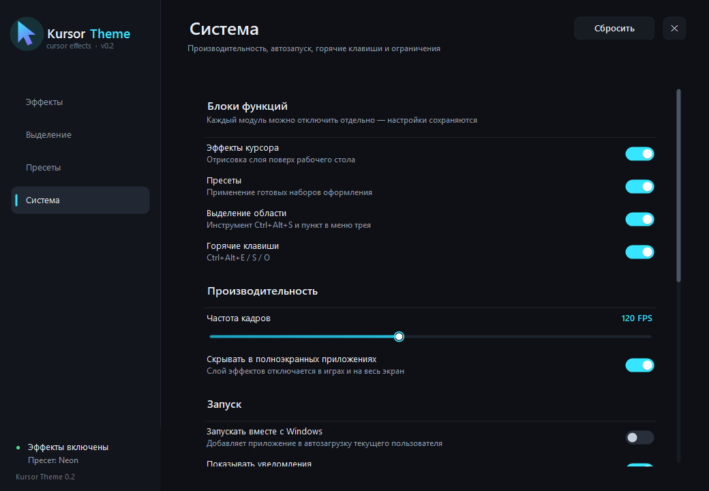

# Kursor Theme

Живые эффекты вокруг курсора и стилизованная область выделения для Windows.

Главный принцип: **системный курсор не подменяется**. Приложение рисует отдельный
прозрачный click-through слой поверх рабочего стола, поэтому текущая схема курсора,
его тени, размер и поведение остаются системными. Эффекты просто живут вокруг него.



## Возможности

### Эффекты курсора
- **Свечение** — мягкий ореол с настройкой цвета, радиуса, яркости, пульсации и скорости.
- **Шлейф** — плавный след за курсором (длина, толщина, прозрачность, цвет).
- **Волна по клику** — расходящиеся кольца в точке нажатия.
- **Частицы** — небольшой салют из точки клика с гравитацией.
- **12 пресетов** — неон, гик, поп, граффити и тату:
  `Neon`, `Ember`, `Aurora`, `Minimal`, `Cyberpunk`, `Synthwave`, `Matrix`,
  `Vaporwave`, `Arcade`, `Hacker`, `Graffiti`, `Tattoo`.
- Всё применяется мгновенно, частота кадров настраивается (30–240 FPS).

### Стилизованное выделение
Вызывается по `Ctrl+Alt+S` поверх любых окон:



- затемнение фона и «дырка» под областью;
- заливка с настраиваемым цветом и прозрачностью;
- **косая штриховка**: цвет, прозрачность, угол, шаг, толщина, анимация и скорость;
- контур со свечением, акценты в углах, бейдж с размером области;
- удержание до `Esc` или автоматическое скрытие.

### Блоки функций
Каждый модуль можно отключить отдельно — в его разделе настроек и в разделе
**Система → Блоки функций**:

- **Эффекты** — полностью останавливает отрисовку.
- **Пресеты** — карточки перестают применяться.
- **Выделение** — горячая клавиша и пункт в трее не срабатывают.
- **Горячие клавиши** — все глобальные сочетания отключаются, настройки остаются доступны из трея.

Состояние сохраняется в конфиге и переживает перезапуск.

| Пресеты | Система |
| --- | --- |
|  |  |

## Горячие клавиши

| Клавиши | Действие |
| --- | --- |
| `Ctrl + Alt + E` | Включить / приостановить эффекты |
| `Ctrl + Alt + S` | Выделить область (повторно — отмена) |
| `Ctrl + Alt + O` | Открыть настройки |
| `Esc` | Отменить выделение |

В режиме выделения: левая кнопка — протянуть область, правая кнопка или `Esc` — выйти.

## Установка и запуск

### Установщик
`dist\KursorThemeSetup.exe` — установка для текущего пользователя, без прав администратора.
Создаёт ярлык в меню «Пуск» (опционально — на рабочем столе) и запись в
«Установка и удаление программ». Удаление — через неё же или `Uninstall.exe` в папке установки.

Установка по умолчанию: `%LOCALAPPDATA%\Programs\KursorTheme`.

### Портативная версия
- `dist\KursorTheme.exe` — один self-contained файл, .NET устанавливать не нужно.
- `dist\KursorTheme-portable.zip` — тот же файл + README.

Запустите — приложение появится в системном трее.

### Из исходников
```powershell
.\build.ps1
.\run.ps1
.\run.ps1 --settings   # сразу открыть панель настроек
```

Скрипты сами находят локальный SDK в `%LOCALAPPDATA%\Microsoft\dotnet`
(он был установлен без прав администратора) и используют системный `dotnet`, если локального нет.

## Сборка релиза

```powershell
.\publish.ps1        # publish\KursorTheme.exe (self-contained, win-x64)
.\make-installer.ps1 # dist\KursorTheme.exe + portable.zip + KursorThemeSetup.exe
```

NSIS для установщика скачивается автоматически в `tools\nsis` (портативно, без установки).
Подробности — в [docs/DEVELOPMENT.md](docs/DEVELOPMENT.md).

## Как это устроено

- **WinForms / .NET 8**. Оверлей — layered-окно
  (`WS_EX_LAYERED | WS_EX_TRANSPARENT | WS_EX_TOOLWINDOW | WS_EX_NOACTIVATE`),
  растровый слой с попиксельной альфой через `UpdateLayeredWindowIndirect`
  и обновлением только «грязных» прямоугольников.
- Отдельный render-поток, целевые ~120 FPS; позиция курсора и кнопки читаются через
  `GetCursorPos` / `GetAsyncKeyState` (без глобальных хуков).
- Выделение — отдельное интерактивное layered-окно с затемнением, штриховкой и анимацией.
- Системный курсор не скрывается и не перерисовывается.

## Ограничения

- Системную рамку/подсветку выделения Windows (проводник, Word и т.п.) перекрасить нельзя —
  она рисуется оболочкой. Поэтому стилизованное выделение сделано собственным инструментом.
- Слой не виден на защищённом рабочем столе и в окнах UAC, а также поверх приложений,
  запущенных с более высокими правами (ограничение UIPI).
- В эксклюзивном полноэкранном режиме слой автоматически скрывается (настройка «Скрывать
  в полноэкранных приложениях»), чтобы не мешать играм.
- В мультимониторной конфигурации эффекты работают на всех экранах; подсказка выделения
  и окно настроек показываются на основном мониторе.

## Конфигурация

`%APPDATA%\KursorTheme\settings.json` — настройки.
`%APPDATA%\KursorTheme\logs\app.log` — ошибки.

## Структура

```
src/KursorTheme/
  App/            трей, горячие клавиши, тёмное меню
  Config/         модель настроек, JSON, пресеты, SettingsHub
  Interop/        Win32 P/Invoke
  Overlay/        оверлей эффектов, движок, окно выделения
  Rendering/      layered canvas, общие кисти/штриховка
  UI/             панель настроек и кастомные контролы
  Support/        лог, автозапуск, системные утилиты
docs/             скриншоты и документация для разработчиков
installer/        NSIS-скрипт установщика
tools/            генерация иконки
```

## Планы

- Собственный дизайн курсора как опция (сейчас сознательно не трогаем системный).
- Эффект прокрутки колесом, «фонарик»/spotlight, копирование области выделения.
- Профили настроек и горячие клавиши под конкретные приложения.
